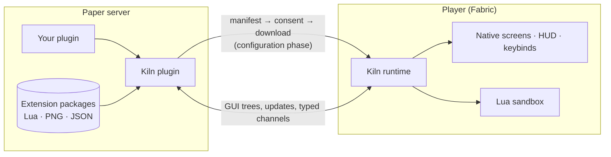

<p align="center">
  <picture>
    <source media="(prefers-color-scheme: dark)" srcset="docs/assets/kiln-logo-dark.svg">
    
  </picture>
</p>

<p align="center">
  <b>Server-driven client content for Paper.</b><br>
  Real GUIs, keybinds and sandboxed Lua extensions, shipped by the server and rendered natively on the client.
</p>

<p align="center">
  <a href="https://github.com/SLNE-Development/kiln/actions/workflows/build.yml"></a>
  
  
  
  
</p>

---

> **Status: prototype.** APIs, protocol and package format still change between versions.

## What is Kiln?

Vanilla Minecraft offers servers no real way to show custom user interfaces: chest menus, books and dialogs can be
bent into shape, but always with hacks such as core shaders or font tricks. Kiln takes a different route, similar to
FiveM or Garry's Mod:

- Players install the **Kiln runtime** once, a small Fabric mod.
- Everything client-side a server needs comes **from the server**: GUI trees, keybinds, textures and Lua scripts.
- Game logic, money, items and validation stay on the **Paper server**. The client only renders and reports input.
- Server scripts run in a **sandbox** (LuaJ without `io`, `os`, `debug`, `load` or Java access, with instruction,
  memory and rate budgets). Players see which permissions an extension wants and agree **before** anything is
  downloaded.
- There are no fallbacks: players without the runtime, with another protocol version, who decline or whose
  extensions fail to load are disconnected with a clear reason.



## Two ways to build UIs

**1. Server-defined screens** with the Kotlin DSL. The server sends a tree of elements and live updates; the
client keeps focus, scroll position and text input across updates.

```kotlin
player.openScreen(220, 120) {
    panel(width = 220, height = 120) {
        layout = Layout.Column(gap = 6, padding = 10)
        text("Energie: ${machine.energy} %")
        progressBar(machine.energy / 100f, width = 200)
        button("toggle", if (machine.running) "Ausschalten" else "Einschalten") {
            onClick { machine.running = !machine.running; it.screen.refresh() }
        }
    }
}
```

**2. Lua extensions** for anything that needs client-side logic: custom widgets, HUD overlays, keybinds, full
screens. The API extension `ui_kit` provides buttons, tabs, dropdowns, sliders, tables, scroll panels, modals and
item slots.

```lua
local ui, keys, net = kiln.ui, kiln.keys, kiln.net
local hello = net.channel("hello")

keys.bind("hello", { name = "Hallo an Server", default = "J", press = function()
  hello:send({ text = "Hallo vom Client!" })
end })

hello:on(function(msg) ui.toast("Server", msg.text) end)
```

```kotlin
val ext = registerExtension("kiln_example")              // from the plugin's resources
ext.channel<HelloMessage>("hello") { player, msg -> send(player, HelloMessage("Hallo zurück, ${player.name}!")) }
```

## Modules

| Module | Kind | Artifact |
|---|---|---|
| `protocol` | plain Kotlin/JVM, no Minecraft | messages, GUI tree, binary codec, limits |
| `server-api` | Kotlin, `compileOnly` paper-api | API for Paper plugins: screen DSL, keybinds, extensions, typed channels |
| `server` | Paper plugin `Kiln` | `kiln-server-<v>.jar` (shades `protocol`, `server-api`, Kotlin stdlib) |
| `client` | Fabric mod `kiln` | `kiln-client-<v>.jar` (`protocol` and LuaJ as nested jars) |
| `example-server` | Paper plugin `KilnExample` | demos and Lua extensions, see below |

## Getting started

Requirements: Java 25. Gradle downloads everything else.

```sh
./gradlew build                     # all modules, including tests
./gradlew :example-server:runServer # Paper 26.3 with Kiln and the demos (run/server)
./gradlew :client:runClient         # Minecraft 26.3 with the Kiln runtime (client/run), offline user "Ammo"
```

Connect the dev client to the server. On the first join you see the consent screen, then the loading screen, then
the world. Players need `kiln-client-<v>.jar`, Fabric API and Fabric Language Kotlin.

### Demos

| Command | Key | What it shows |
|---|---|---|
| `/pbdemo` | G | server-defined factory screen with live updates, gauge widget from Lua |
| `/shop` | K | full-screen market as a Lua screen on `ui_kit` (server-rendered twin: `/shopdsl`) |
| `/fabrik` | B | machine control: list, details, toggles, slider, dropdown |
| `/quests` | U | quest log with tabs, progress and reward items |
| `/warps` | V | warp tiles, search, favourites, teleport with cooldown |
| `/bestenliste` | N | sortable leaderboard table and bar chart |
| `/profil` | M | settings form with live preview and unsaved-changes dialog |

## Documentation

- [`docs/design.md`](docs/design.md): architecture, protocol, GUI elements, keybinds
- [`docs/lua-extensions.md`](docs/lua-extensions.md): extension packages, delivery, consent, sandbox, Lua API
- [`docs/ui_kit.md`](docs/ui_kit.md): the `ui_kit` component library

Targets: Minecraft 26.3, Paper `26.3.build.256-stable`, Fabric Loader 0.20.1, Fabric API `0.164.0+26.3`,
Kotlin 2.4.21, LuaJ 3.0.1 (Lua 5.2).
